<div align="center">

# Stride

**A personal running coach for your iPhone. It builds a plan around your race and your week, then helps you follow it.**


<br/>

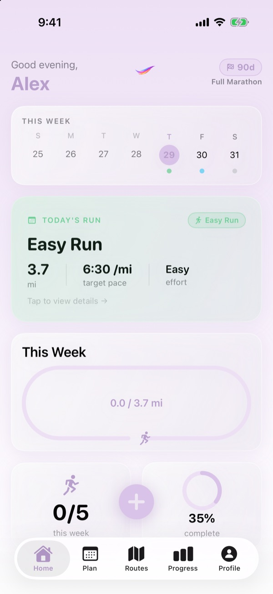
&nbsp;&nbsp;
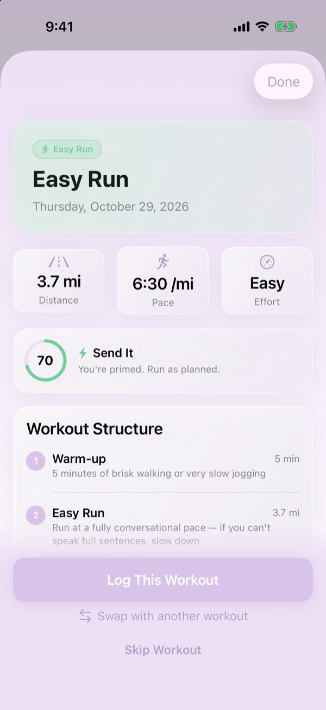
&nbsp;&nbsp;
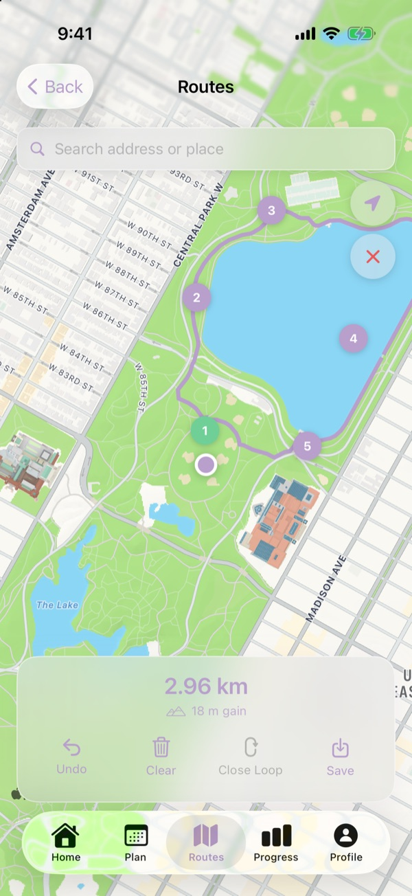

</div>

---

## What is Stride?

Stride is a native iOS app for runners who are training for a road race. You tell it your race, your race date, how much you're running now and which days you can train. It then builds a periodised day-by-day plan from today through race day.

It's meant to feel like a proper coaching app, without the subscription. There are no accounts and no servers. Your data stays on your phone.

**Supported races:** 5K · 10K · Half Marathon · Full Marathon
**Supported runners:** Beginner, Intermediate and Advanced

---

## Features

### Onboarding that meets you where you are

Six quick steps take you from "hi" to a full training plan. If you connect Apple Health, Stride reads your recent runs and fills in your fitness profile for you. If you're already partway through a training block, Stride works out which week of the plan you should start in. That way an 18-week plan doesn't force you back to week 1.

<table>
  <tr>
    <td align="center">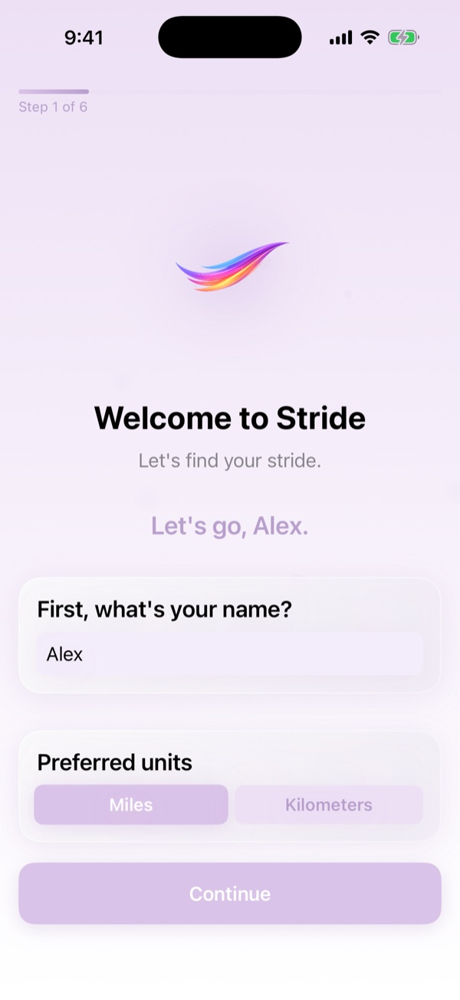<br/><sub>Welcome</sub></td>
    <td align="center">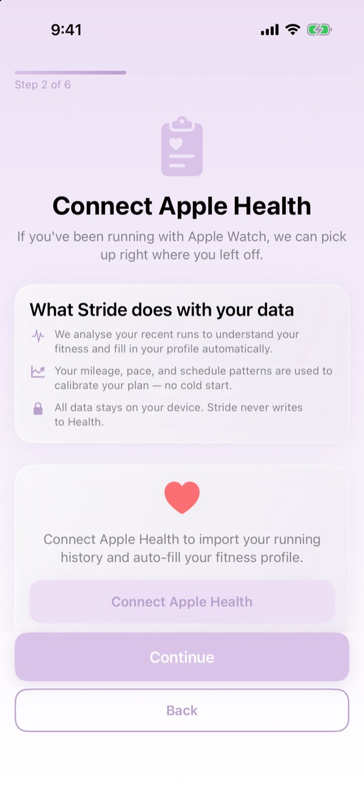<br/><sub>Apple Health sync</sub></td>
    <td align="center">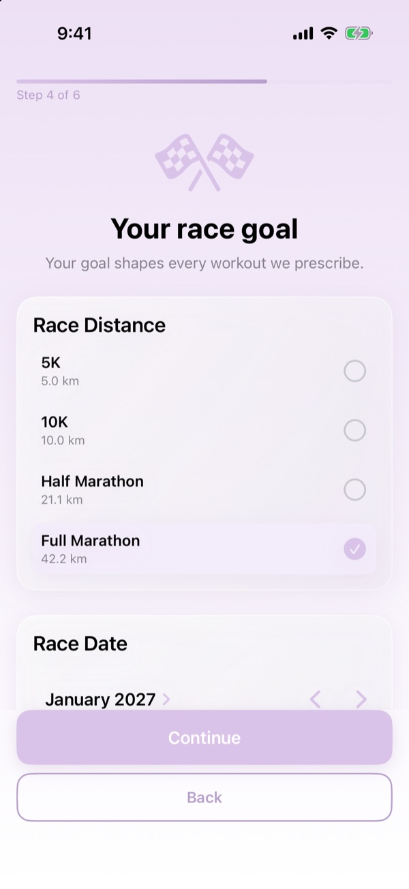<br/><sub>Race goal</sub></td>
  </tr>
  <tr>
    <td align="center">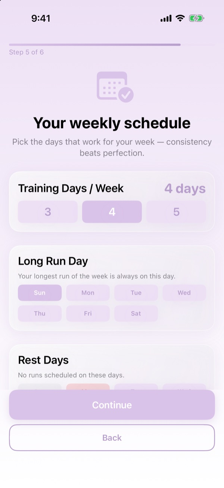<br/><sub>Weekly schedule</sub></td>
    <td align="center">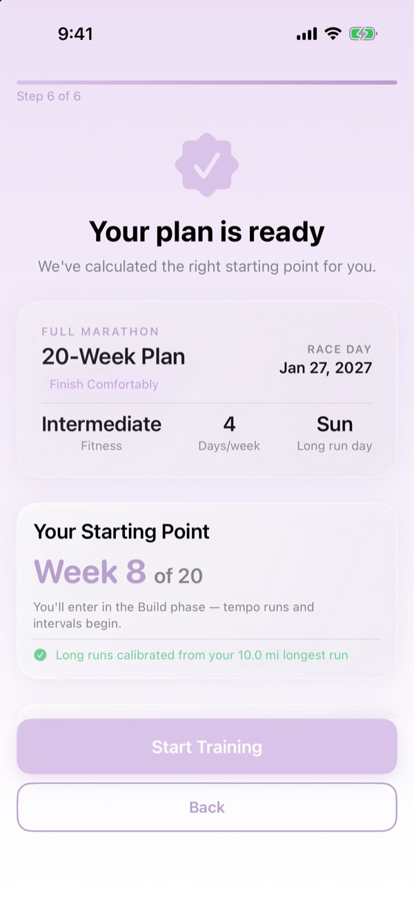<br/><sub>Plan preview</sub></td>
    <td></td>
  </tr>
</table>

### A plan built on real training principles

- **Periodised:** Base → Build → Peak → Taper, sized to your race and fitness level.
- **Safe progression:** weekly mileage never goes up by more than 10%. This is a hard cap in the generator, not a suggestion.
- **Fits your week:** 3, 4 or 5 training days, your choice of long-run day, and rest days where you want them.
- **Varied workouts:** easy runs, long runs, tempo, intervals, recovery runs, strength days and rest days. Each one comes with a target distance, pace and effort level.
- **Beginner-friendly:** early base weeks use run/walk intervals for newer runners.

### Daily Ready Check

Before a workout, rate your sleep, soreness, energy and motivation. The readiness engine combines those ratings with context: how hard yesterday was, whether you're already over this week's mileage, and which training phase you're in. If Apple Health has sleep data, it's blended in too. The result is a score and one clear call:

| Recommendation | What it means |
|---|---|
| **Send It** | You're primed. Run as planned. |
| **Dial Back** | Same workout, about 15–20% easier. |
| **Swap to Recovery** | Replace it with an easy 20-minute shakeout. |
| **Rest Today** | Take the day and swap with tomorrow. |

Hard sessions like tempo and intervals need a higher readiness score than easy days. Any change to your plan is a suggestion you approve, and you can undo it.

<table>
  <tr>
    <td align="center">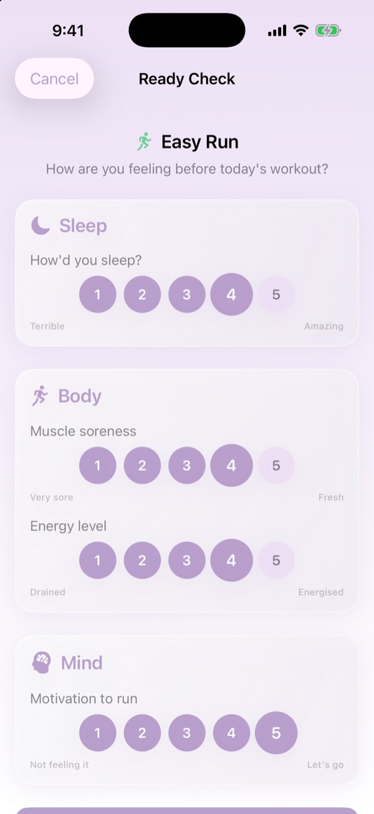<br/><sub>Check-in</sub></td>
    <td align="center">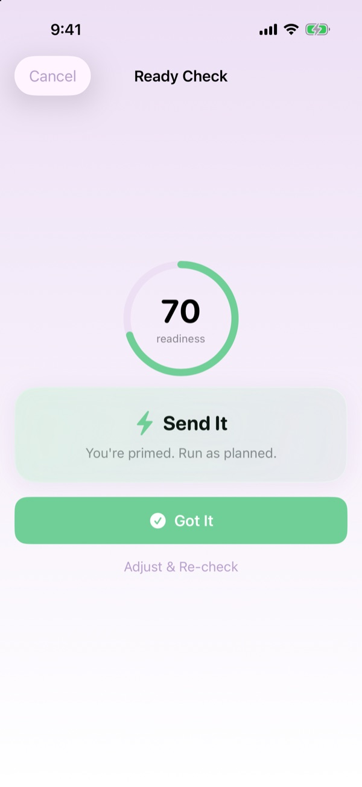<br/><sub>Recommendation</sub></td>
  </tr>
</table>

### Log runs your way

Tap the **+** button to log a workout. You can import it from Apple Health, where Stride matches it to today's planned session and pre-fills the form, or enter it by hand. Life happens, so you can also **swap** a workout with another day in the surrounding week. Stride warns you if a swap would put two hard days back to back.

<table>
  <tr>
    <td align="center"><br/><sub>Workout detail</sub></td>
    <td align="center">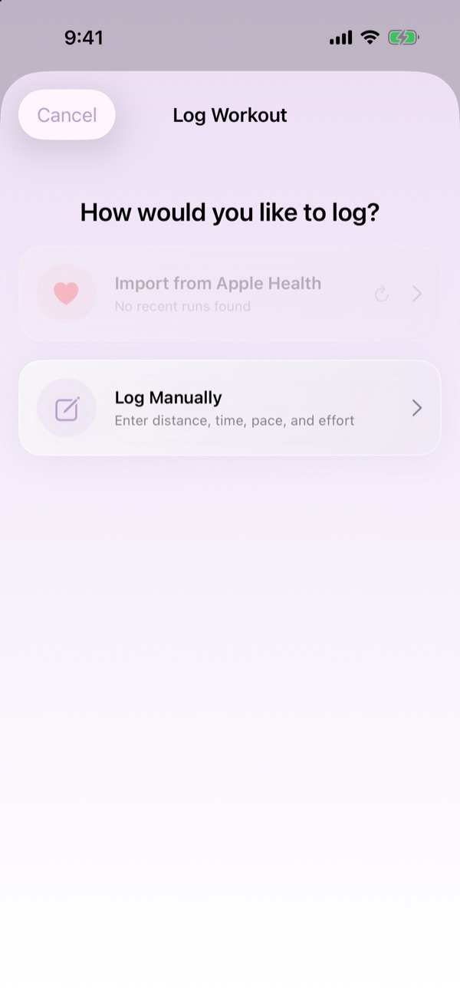<br/><sub>Log a workout</sub></td>
  </tr>
</table>

### Route planner

Tap the map to drop waypoints and Stride snaps the route to real roads and paths with MapKit. You get live distance and elevation gain as you go. Close it into a loop, save it, and attach it to a workout. You can share routes as `.stride` or `.gpx` files and import GPX files from other apps. Bundled Quick Look and thumbnail extensions mean `.stride` files show a map preview right in Files and Messages.

<p align="center"></p>

### Calendar, progress and profile

- **Plan:** a month-by-month calendar with each day colour-coded by workout type, plus weekly mileage.
- **Progress:** projected finish time using the Riegel formula, from a recent race time or your logged runs, plus overall plan progress and training stats.
- **Profile:** a snapshot of where you are in the plan, your race goal and your settings.

<table>
  <tr>
    <td align="center">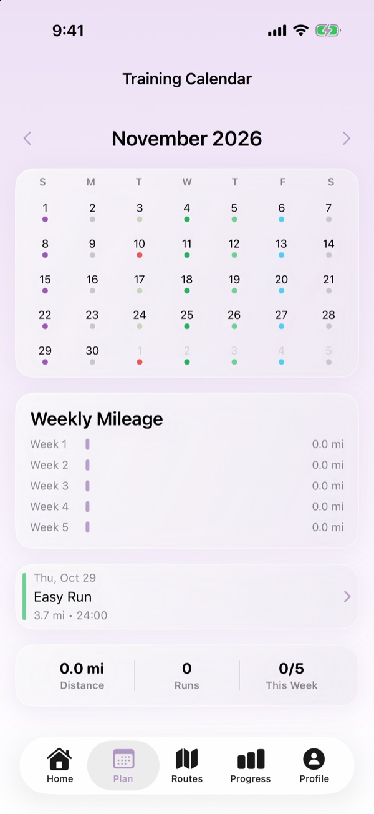<br/><sub>Plan</sub></td>
    <td align="center">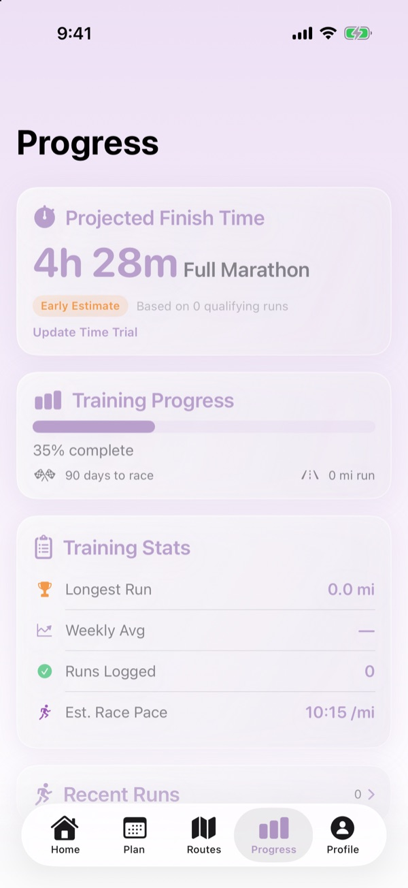<br/><sub>Progress</sub></td>
    <td align="center">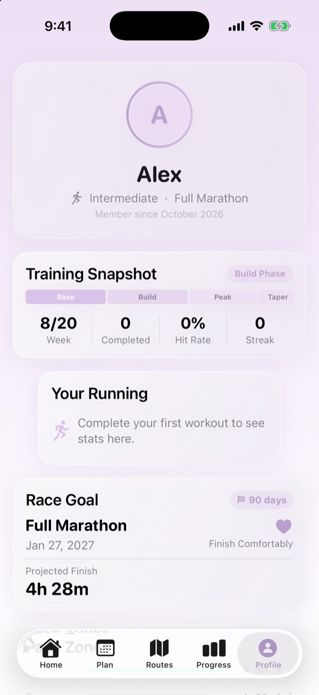<br/><sub>Profile</sub></td>
  </tr>
</table>

### Gentle nudges

All notifications are local, so there's no push server involved:
- A daily workout reminder at a time you choose
- A weekly summary on Sunday evening
- A motivational nudge if you miss a workout, after a 48-hour grace period

---

## Tech Stack

| | |
|---|---|
| **Language** | Swift 5.10+ |
| **UI** | SwiftUI only (no UIKit views) |
| **State** | `@Observable` macro |
| **Persistence** | SwiftData |
| **Health** | HealthKit (read-only; Stride never writes to Health) |
| **Maps** | MapKit + CoreLocation (`MKDirections` for road-snapped routes) |
| **Notifications** | `UserNotifications` (local only) |
| **Dependencies** | None. 100% first-party Apple frameworks. |

---

## Architecture

Stride follows a strict **MVVM** setup:

```
View  →  ViewModel  →  Services  →  Models (SwiftData)
```

- **Views** handle layout only, with no business logic.
- **ViewModels** are `@Observable` classes that own state and logic.
- **Services** are plain Swift types that are injected, never created inside views. Examples: `TrainingPlanGenerator`, `ReadinessEngine`, `PlanAdaptationEngine`, `FinishTimeEstimator`, `RouteService` and `HealthKitManager`.
- **Models** are SwiftData `@Model` classes that hold data only.

```
Stride/
├── Core/
│   ├── Models/        # SwiftData models + enums
│   ├── Services/      # Plan generation, readiness, HealthKit, routes, notifications…
│   └── Extensions/
├── UI/                # Design system + reusable components (GlassCard, StrideButton)
└── Features/          # Onboarding, Dashboard, Calendar, Workout, Routes,
                       # Progress, ReadyCheck, Profile, Debug
StrideQuickLook/       # Quick Look preview for .stride route files
StrideThumbnail/       # File thumbnails for .stride route files
```

Want to go deeper? Start here:

- [`docs/ARCHITECTURE.md`](docs/ARCHITECTURE.md): full SwiftData schema and data flow
- [`docs/TRAINING_PLAN_LOGIC.md`](docs/TRAINING_PLAN_LOGIC.md): how plans are generated
- [`docs/DESIGN_SYSTEM.md`](docs/DESIGN_SYSTEM.md): colours, typography and components
- [`docs/REQUIREMENTS.md`](docs/REQUIREMENTS.md): the product requirements

---

## Getting Started

### Requirements

- macOS with **Xcode 16** or later
- iOS **18.0+** simulator or device (iPhone)

### Build & run

```bash
git clone https://github.com/thomaskahessay/Stride.git
```

```bash
cd Stride && open Stride.xcodeproj
```

Pick the **Stride** scheme and an iPhone simulator, then hit **⌘R**. To build from the command line instead:

```bash
xcodebuild -scheme Stride -destination 'platform=iOS Simulator,name=iPhone 17 Pro' build
```

> **Heads up:** HealthKit doesn't have real workout data in the simulator. Onboarding works fine without it. To see the Health-driven features, run on a device or use the debug tools below.

### Debug tools

Debug builds include a hidden **Debug Tools** panel. To open it, triple-tap the app info footer at the bottom of the Profile tab. It has:
- **Time travel:** move the app's clock forward or back a day or week at a time to see how the plan and adaptations change over time.
- **Mock HealthKit:** feed fake runs into the app so you can test imports and finish-time projections without going for a run.

---

## Roadmap

- [x] Personalised plan generation (5K → Marathon)
- [x] Daily Ready Check + adaptive recommendations
- [x] Apple Health import
- [x] Route planner with GPX/`.stride` import and export
- [x] Workout swapping
- [ ] Home Screen widget for today's run
- [ ] Apple Watch companion app
- [ ] Custom race distances

---

<div align="center">
<sub>Built with SwiftUI and a lot of easy miles.</sub>
</div>
